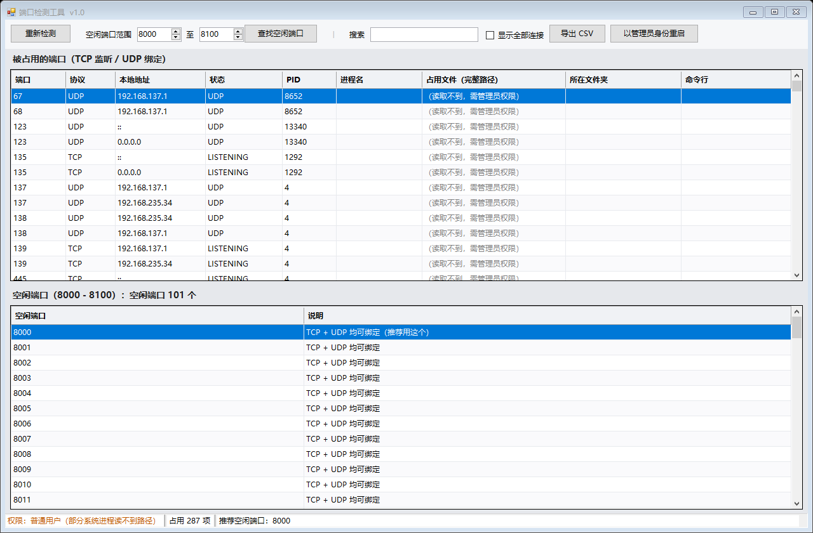

# 端口检测工具

Windows 上的免安装端口查看小工具：双击就能看到本机哪些端口被占用、被哪个文件占用、在哪个文件夹，以及指定范围内哪些端口空闲。



## 功能

- 列出所有 **TCP 监听** 与 **UDP 绑定** 的端口
- 显示占用进程的 PID、进程名、文件完整路径、所在文件夹
- 在指定端口范围内查找空闲端口
- 复制整行、复制文件路径、打开文件所在文件夹、结束进程
- 普通用户即可运行；需要查看系统进程时可在界面内以管理员身份重启

## 下载使用

直接下载 [`dist/端口检测工具.exe`](dist/端口检测工具.exe)，双击运行，无需安装任何依赖（需要 .NET Framework 4.x，Windows 10/11 自带）。

详细说明见 [使用说明.txt](使用说明.txt)。

## 构建

源码是单文件 C#（`src/PortInspector.cs`），用 .NET Framework 自带的 `csc.exe` 编译，不需要 Visual Studio：

```bat
cd src
编译.bat
```

产物输出到 `dist/端口检测工具.exe`。编译脚本会自动在 64 位与 32 位的 `csc.exe` 之间选择。

## 目录

| 路径 | 说明 |
| --- | --- |
| `src/` | 源码、应用清单、编译脚本 |
| `dist/` | 编译产物 |
| `docs/` | 截图 |
| `使用说明.txt` | 面向使用者的操作说明 |

## 致谢

功能设计参考了 [PortTools](https://github.com/niushuai233/PortTools)。

本项目为独立实现：与上游源码逐行比对后，完全相同的只有 `using System.*;`、`return null;`、`Application.EnableVisualStyles();` 这类通用样板，共 22 行，**没有任何业务逻辑重合**。

## 许可

[MIT](LICENSE)
